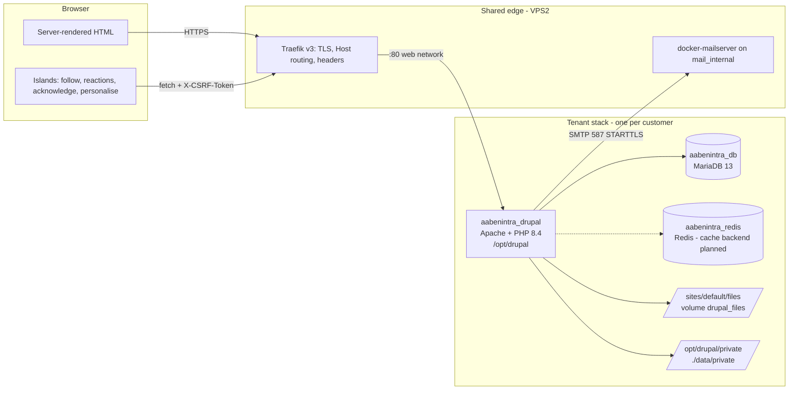
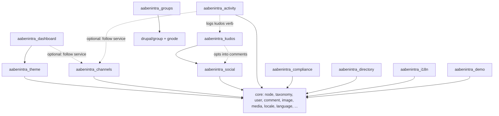

# Architecture

AabenIntra is a themed Drupal 11 intranet for Danish organisations (kommuner
and companies), shipped as one container per tenant. Authoring, preview,
permissions and translation are native Drupal; the product adds a content
model, groups, social features, compliance tooling, a bilingual UI and a
front-end theme with small progressive-enhancement "islands". This document is
the map. Detailed how-tos live in `docs/`.

## Design choices in one paragraph each

**Recipe-first, no config sync.** The product is a set of Drupal recipes
(`web/recipes/`) plus module install hooks, applied imperatively by
`scripts/install_prod.sh`. There is no `config/sync` directory in use and
`drush cim` is never run: ongoing deploys execute `drush cr && drush updb`
only (`scripts/deploy_post.sh`, `skip_cim: true` in the deploy dispatch).
Reasons: a config export is tied to one site UUID and hard-fails on a foreign
site, whereas recipes strip UUIDs and apply anywhere; a config import deletes
active config that is not in the export, which on an intranet that tenants
customise (menus, terms, colours, group types) means destroying their work;
and a recipe is additive and idempotent, so the same artefact bootstraps a new
tenant and is safe to re-run on an old one. Changes to existing tenants travel
as `hook_update_N()`. See [docs/RECIPES.md](docs/RECIPES.md).

**Themed Drupal, not headless.** Pages are rendered by Drupal with the
`aabenintra` theme (front end) and Gin (admin). There is no SPA and no public
API today ([docs/API.md](docs/API.md)). JavaScript is confined to islands
that upgrade server-rendered markup and talk to private `/aabenintra/*`
endpoints ([docs/ISLANDS.md](docs/ISLANDS.md)). This keeps editorial
preview, access control, caching and translation in one system and makes the
no-JS and screen-reader paths the default rather than a port.

**Container per tenant.** A tenant is one `docker-compose.yml` stack: Drupal
(Apache + PHP 8.4), MariaDB 13 and Redis, with its own `.env`, database,
files volume and private directory, routed by hostname through the shared
Traefik. Isolation is at the process and database level, not at the row
level. See `docs/TENANT-ISOLATION.md` for the isolation model and
verification tests.

## Runtime topology



Networks: `web` (external, shared with Traefik), `internal` (per tenant, DB
and Redis only), `mail_internal` (external, to the mail server). The DB and
Redis publish no ports. Secrets come from the tenant `.env` and are read in
`settings.php` via `getenv()`; nothing sensitive is committed.

## Request flow

1. Traefik terminates TLS for the tenant hostname and proxies to the Drupal
   container on port 80. `settings.php` sets `reverse_proxy = true` and trusts
   the immediate proxy address so Drupal sees the real scheme and client IP.
2. Drupal's language negotiation reads the URL prefix first (`/da/...`),
   then the user's saved language, then the site default (`en`). This order
   is asserted in `install_prod.sh` because the recipe cannot guarantee it.
3. Routing resolves to a core/contrib route (node view, group page, admin)
   or to one of the custom controllers (`/dashboard`, `/news`, `/channels`,
   `/activity`, `/directory`, `/experts`, `/org-chart`, `/kudos`).
4. Access: node access plus drupal/group access for group content; custom
   `hook_group_access` hides "secret" groups from non-members. **uid 1 does
   not bypass group access** (group 3 "flexible permissions"), which is why
   the install script grants the administrator role `administer group` and
   `access group overview`.
5. Rendering: controllers return render arrays with explicit cache contexts
   and tags. Personalisation is expressed as cache metadata, not as
   per-request `max-age: 0`, except where correctness demands it (the
   mandatory-read banner). Two custom contexts keep the cache from exploding:
   `aabenintra_user_prefs` (hash of accent, scheme, density) and
   `aabenintra_user_groups` (hash of org unit + group memberships).
6. Theme: `aabenintra_theme_preprocess_html()` writes `data-accent`,
   `data-color-scheme`, `data-density`, `data-nav` onto `<html>` so the user's
   look is right on first paint; `aabenintra_theme_page_attachments()` hands
   `drupalSettings.aabenintra` (prefs, endpoint, CSRF token) to the theme JS.
7. Islands then attach: `Drupal.behaviors` + `once()` for module islands,
   one `DOMContentLoaded` entry for the theme chrome. Writes go to
   `/aabenintra/*` with the island's CSRF token and the response is applied
   to the DOM.
8. Dynamic Page Cache and the render cache (database today, Redis when
   enabled) serve repeat requests; Internal Page Cache is irrelevant because
   every page is authenticated.

## Module map

All custom modules live in `web/modules/custom/`, package `AabenIntra`,
`core_version_requirement: ^11`, `php: ^8.3`, `declare(strict_types=1)` and
`final` classes throughout.

| Module | Purpose | Routes | Services | Own tables / storage |
| --- | --- | --- | --- | --- |
| `aabenintra_theme` | Per-user preferences (accent, scheme, density, nav, tile order/pins) in `user.data`; term colour resolver; cache contexts; seeds the default main menu | `GET/PATCH /aabenintra/preferences` | `aabenintra_theme.preferences`, `aabenintra_theme.term_color`, `cache_context.aabenintra_user_prefs`, `cache_context.aabenintra_user_groups` | `user.data` (module `aabenintra_theme`, key `prefs`); creates `field_color` / `field_icon` on terms via update 9001 |
| `aabenintra_dashboard` | Personalised Story tile dashboard scoped by org unit cascade and followed channels; pinned first, then saved order | `/dashboard` | - | - (reads prefs and follow service) |
| `aabenintra_channels` | Topics as followable channels; `/channels` directory, `/news` mixing followed + org-wide | `/channels`, `/channels/{tid}`, `/news`, `POST /aabenintra/follow/{tid}` | `aabenintra_channels.follow` | `aabenintra_follow` (generic `target_type`, `topic` today) |
| `aabenintra_social` | Threaded core comments and one-per-user reactions on Story + Document (Kudos opts in) | `POST /aabenintra/react/{node}/{reaction}` | `aabenintra_social.reaction` | `aabenintra_reaction`; shared `field_comments` storage |
| `aabenintra_kudos` | Peer recognition: Kudos node type (recipient, badge, message), recognition wall | `/kudos` | - | fields `field_recipient`, `field_badge`; depends on `aabenintra_social` |
| `aabenintra_activity` | Chronological feed of published content, comments and kudos scoped to org + groups + followed channels; backfill drush command | `/activity` | `aabenintra_activity.activity` | `aabenintra_activity` |
| `aabenintra_compliance` | Mandatory reading: `field_mandatory` on Story + Document, acknowledgement banner and receipt, admin report + CSV | `POST /aabenintra/acknowledge/{node}`, `/admin/reports/mandatory-reads`, `.../csv` | `aabenintra_compliance.receipts` | `aabenintra_read_receipt` |
| `aabenintra_directory` | Employee profiles (job title, phone, skills, photo), searchable directory, org chart, "find an expert" | `/directory`, `/experts`, `/org-chart` | - | `skills` vocabulary; user fields |
| `aabenintra_groups` | Workspace + Community group types, Document/Tip content plugins, member roles, visibility field and secret-group access; built in code | - (group routes are contrib) | - | Tip node type + fields; group fields `field_group_visibility` / `_description` / `_image` |
| `aabenintra_i18n` | Ships Danish `.po` for the custom UI strings; imported in `hook_install()` as customised translations | - | - | `translations/aabenintra.da.po` |
| `aabenintra_demo` | Demo departments, topics, users, media, stories; `drush aabenintra:demo-seed` / `demo-clear`; **never in production** | - | `aabenintra_demo.generator` | - |

Drush commands: `aabenintra:demo-seed`, `aabenintra:demo-clear`,
`aabenintra_groups:install-plugins`, `aabenintra_activity:backfill`.

### Module dependencies



Solid = `dependencies:` in `.info.yml`. Dashed = runtime coupling guarded by
`\Drupal::hasService()` or by field existence, so the modules can be enabled
independently.

## Content and data model

- **Content types** (recipe `aabenintra_content`): `story` (lead image,
  department, topics, audience, tile size, pinned, org unit, location),
  `event` (date, department, org unit, location), `document` (file, topics,
  department, org unit, location). From module installs: `tip` (groups),
  `kudos` (kudos), `page` (Standard).
- **Vocabularies**: `department`, `topic` (= channels), `audience`,
  `organisation` (hierarchical with `field_org_level`), `location`,
  `skills`. Terms carry `field_color` / `field_icon` resolved by
  `TermColor` (explicit hex or a deterministic OKLCH slot by term id).
- **Users**: `field_primary_org_unit`, `field_location` (content recipe) plus
  `field_job_title`, `field_phone`, `field_skills`, `field_photo`
  (directory).
- **Groups**: types `workspace` and `community`; content plugins
  `group_node:document`, `group_node:tip`; role `<type>-member` (insider
  scope, mapped to `authenticated`); visibility open / closed / secret.
- **Custom tables**: `aabenintra_activity`, `aabenintra_follow`,
  `aabenintra_reaction`, `aabenintra_read_receipt`. All have a unique key
  that makes writes idempotent (`merge()`), which the islands and the PWA
  sync design rely on.

## Theming

- **Admin**: Gin (`gin`, `gin_toolbar`, horizontal classic toolbar, auto dark
  mode), set as admin theme by the base recipe; node forms use the admin
  theme.
- **Front end**: `web/themes/custom/aabenintra`, base theme `stable9`,
  generated from `starterkit_theme`. Starterkit component CSS is kept in
  `css/components/` (library `aabenintra/base`); the design layer lives in
  `src/` and is built by Vite into `dist/main.css` and `dist/main.js`
  (library `aabenintra/global`), with fonts (Inter, Newsreader variable)
  copied to `dist/fonts/`. Stable file names, no content hashes, so the
  output is diffable and `dist/` is committed. The Docker image runs no Node;
  committed `dist/` is the production transport.
- **Tokens**: `src/css/tokens.css` defines OKLCH colour tokens and the
  accent presets; `data-accent`, `data-color-scheme`, `data-density` on
  `<html>` switch them. A custom accent is an inline `--accent` style.
- **Templates**: bundle templates (`node--story`, `node--event`,
  `node--document`, `node--tip`, `node--kudos`), a full group landing page
  (`group--full`), taxonomy term landing pages, and the page chrome
  (`page.html.twig` with the left nav drawer, language switcher and
  Personalise panel). `aabenintra.theme` precomputes presentation variables
  so Twig stays declarative.

## Internationalisation

Bilingual EN/DA. `en` is the default language; `da` is added at install.
Negotiation is URL-first (`/da` prefix), then the user's account language,
then the selected default. Content translation is enabled for story, event,
document, tip, the taxonomies and groups; config translation for labels is
tracked in #60. Custom UI strings are translated in
`web/modules/custom/aabenintra_i18n/translations/aabenintra.da.po`, imported
as customised strings so `locale:update` does not overwrite them. Every new
`t()` string in a custom module or template needs a `msgid`/`msgstr` pair
there.

## Deploy pipeline

```text
push to main  ->  .github/workflows/deploy.yml
              ->  repository_dispatch "deploy" to madsnorgaard/contabo-infrastructure
                  payload: project_dir, project_type=drupal, run_updb=true, skip_cim=true
              ->  self-hosted runner: git pull on the host, docker compose build + up
              ->  scripts/deploy_post.sh inside the container: drush cr, drush updb, drush cr
```

Pull requests run `.github/workflows/build-check.yml`, which builds the
production image (`docker/Dockerfile`, `drupal:11-php8.4-apache`, `composer
install --no-dev` inside the image). Dependabot opens weekly PRs for
composer, npm (theme), Docker, docker-compose and GitHub Actions. A merge to
`main` deploys to production without a staging hop. The runbook, rollback
procedure and tagging convention are in `docs/DEPLOYMENT.md`; backups in
`docs/BACKUPS.md`.

## Data stores

| Store | What | Where | Backup |
| --- | --- | --- | --- |
| MariaDB 13 | All Drupal tables incl. the four custom tables, `user.data`, sessions | `./data/mysql` bind mount, `internal` network only | nightly DB dump (see `docs/BACKUPS.md`) |
| Public files | Images, media, image-style derivatives, aggregated CSS/JS | named volume `drupal_files` at `web/sites/default/files` | nightly |
| Private files | Document attachments and anything behind `/system/files/` | `/opt/drupal/private` (bind mount `./data/private`), outside the docroot | nightly |
| Redis | Cache backend - **planned**: the `redis` PHP extension is in the image and `drupal/redis` in `composer.json`, but the `$settings['cache']` block in `settings.php` is commented out until `drush en redis` has been run on a tenant | `./data/redis` | not needed (cache) |
| Translations | Imported `.po` strings | database (`locales_*`) plus `files/translations` | with DB |

Sessions use the database with `cookie_samesite: Lax`, 100-day gc lifetime
and a 23-day cookie (`services.prod.yml`); the session and device policy is
being tightened in `docs/SESSION-POLICY.md`.

## Where to read next

- [docs/RECIPES.md](docs/RECIPES.md) - recipe reference, apply order, export workflow
- [docs/ISLANDS.md](docs/ISLANDS.md) - adding progressive-enhancement JS
- [docs/API.md](docs/API.md) and [docs/openapi.yaml](docs/openapi.yaml) - endpoints and versioning policy
- [docs/PWA-OFFLINE.md](docs/PWA-OFFLINE.md) - offline scope and sync design
- `docs/TENANT-ISOLATION.md`, `docs/DEPLOYMENT.md`, `docs/BACKUPS.md`,
  `docs/SECURITY-HEADERS.md`, `docs/QUALITY.md` - operational docs
- [CONTRIBUTING.md](CONTRIBUTING.md) and [SECURITY.md](SECURITY.md)
