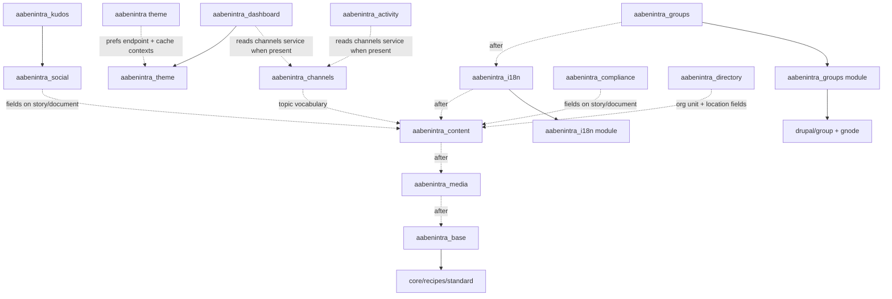

# Recipes

AabenIntra is assembled from Drupal recipes in `web/recipes/` plus the install
hooks of the custom modules in `web/modules/custom/`. There is no config sync
directory and `drush cim` is never run (see [ARCHITECTURE.md](../ARCHITECTURE.md)
for why). This page is the reference for what each recipe does, the order they
must be applied in, and how to get new config into a recipe.

## Recipes that ship today

| Recipe | `recipes:` | `install:` | Config shipped (`config/`) | `config.actions` |
| --- | --- | --- | --- | --- |
| `aabenintra_base` | `core/recipes/standard` | gin, gin_toolbar, admin_toolbar, admin_toolbar_tools, environment_indicator, pathauto, token, layout_builder | none | site name + slogan, admin theme = gin, `node.settings.use_admin_theme`, Gin preset (accent, focus, dark mode auto, horizontal toolbar) |
| `aabenintra_media` | - | media, media_library, image, crop, focal_point, responsive_image, easy_responsive_images | Image media type, `field_media_image` storage + field + displays, image styles `tile_small` / `tile_medium` / `tile_large` | none |
| `aabenintra_content` | - | node, taxonomy, field, text, options, datetime, link | Content types story / event / document; vocabularies department, topic, audience, organisation, location; all field storages and instances (lead image, department, topics, audience, tile size, pinned, event date, document file, org unit, location, term colour/icon/org level); form and view displays for the three node types, the organisation term and **the user entity**; `language.content_settings` for location and organisation terms | none |
| `aabenintra_i18n` | - | language, locale, content_translation, config_translation, aabenintra_i18n | `language.entity.da`, `language.negotiation`, `language.types`, `language.content_settings` for story / event / document and the department / topic / audience vocabularies | `system.site.default_langcode: en` |
| `aabenintra_groups` | - | group, gnode, content_translation, aabenintra_groups | none - everything is built in `aabenintra_groups_install()` | none |

What the groups recipe does not ship as YAML, and why: group relationship
plugins (`group_node:document`, `group_node:tip`) create bundle fields when they
are instantiated. Importing them as plain config leaves the group schema half
committed, so the module creates the Workspace and Community group types, the
visibility / description / cover-image fields, the Tip content type and the
`<type>-member` roles in code, idempotently. If the recipe-time install cannot
finish, it logs a warning and `drush aabenintra_groups:install-plugins` finishes
the job.

## Apply order and why

```text
site:install minimal
  -> aabenintra_base        (pulls core Standard; Gin, pathauto, layout_builder)
  -> aabenintra_media       (Image media type, tile image styles)
  -> [config:delete user displays]
  -> aabenintra_content     (content model; Story.field_lead_image targets media:image)
  -> drush en language locale content_translation config_translation
  -> drush language:add da
  -> aabenintra_i18n        (negotiation, content settings, Danish .po)
  -> drush locale:update
  -> drush en group gnode aabenintra_groups
  -> drush aabenintra_groups:install-plugins
  -> drush en <feature modules>
  -> theme:enable aabenintra, front page = /dashboard
```

The dependency reasons, in order:

1. **base before everything.** It pulls in `core/recipes/standard`, which
   provides the `body` field storage, text formats, the comment type and menus
   that later recipes and module installs reuse rather than redefine.
2. **media before content.** `field.field.node.story.field_lead_image` is an
   entity reference to the `image` media type; the content recipe fails if the
   bundle does not exist yet.
3. **content before i18n and groups.** The i18n recipe's
   `language.content_settings.node.*` and the groups module's Tip type (which
   reuses `body` and references the `topic` vocabulary) need the content model.
4. **i18n before groups.** `aabenintra_groups_install()` enables content
   translation on the Tip type and the group types when `content_translation`
   is present, so apply i18n first to get translatable groups on a fresh tenant.
5. **feature modules last.** `aabenintra_dashboard` depends on
   `aabenintra_theme`; `aabenintra_kudos` depends on `aabenintra_social`;
   `aabenintra_compliance` and `aabenintra_social` attach fields to story and
   document, which must exist.

`scripts/install_prod.sh` is the executable version of this list and is the
source of truth when the two disagree.

## Dependency graph

Solid arrows are hard dependencies (`recipes:` or `install:` keys, module
`dependencies:`). Dashed arrows are ordering constraints enforced only by the
install script.



## Rule: recipes refuse to overwrite differing config

A recipe import is additive. If a config object already exists in active
storage and is byte-identical (ignoring `uuid` and `_core`) the import is a
no-op; if it exists and **differs**, the apply fails. Two places where this bites
on every fresh tenant:

- **User displays.** `core/recipes/standard` creates
  `core.entity_form_display.user.user.default` and the matching view display
  (with `user_picture`). The content recipe ships its own versions that add
  `field_primary_org_unit` and `field_location`. `install_prod.sh` deletes the
  Standard versions right before applying the content recipe:

  ```bash
  drush config:delete core.entity_form_display.user.user.default
  drush config:delete core.entity_view_display.user.user.default
  drush recipe web/recipes/aabenintra_content
  ```

  The recipe's copies are authoritative (they include `user_picture` too).

- **Language negotiation.** Enabling `language` inside a recipe does not fully
  register its service container (`path_processor_language` is missing until
  the container rebuilds), so URL negotiation is inactive until the modules are
  enabled via drush. The install script enables them first, applies the recipe,
  then re-asserts URL-first interface negotiation via
  `language_negotiator->saveConfiguration()` as a defensive fallback.

When you hit "config X already exists and differs" on a new recipe, the choices
are (in order of preference): make the recipe's copy identical to what earlier
steps produce, move the object into the recipe that first creates it, or add a
guarded `config:delete` to `install_prod.sh` with a comment explaining why.

Re-applying a recipe on an existing site is cheap and safe for identical config
(that is why `install_prod.sh` is re-runnable), but it will never update
config that an editor has since changed. Updates to existing tenants go
through `hook_update_N()` in the owning module, which `scripts/deploy_post.sh`
runs on every deploy.

## Exporting new config into a recipe

1. Build the config on a local site (DDEV), through the UI or a one-off
   builder script such as `scripts/build_model.php` or
   `scripts/build_structure.php`.
2. Add the config names to the map in the matching export script and run it:

   ```bash
   ddev drush scr scripts/export_to_recipes.php          # media + content
   ddev drush scr scripts/export_structure.php           # organisation/location model
   ddev drush scr scripts/export_recipes_i18n_groups.php # i18n + groups + document
   ```

   The scripts read active storage, strip `uuid` and `_core`, and write
   `web/recipes/<recipe>/config/<name>.yml`. Stripping the UUID is what makes
   the YAML importable on any site; a UUID mismatch is the classic reason
   `drush cim` hard-fails against foreign config (issue #45).
3. Verify on a throwaway site: `drush site:install minimal` and run the apply
   order above. Recipes are only tested by applying them.
4. If the config lives on a bundle created by a module install hook (Tip,
   Kudos, the group types), it belongs in that module's `hook_install()`, not
   in a recipe.

Config `.yml` files in a recipe never contain `uuid:` or `_core:`. Review PRs
for that.

## Planned recipes

Tracked in GitHub milestones; none of these exist in `web/recipes/` yet.

| Recipe | Issue | Status | Scope |
| --- | --- | --- | --- |
| `aabenintra_social` | #24 | planned | Package the shipped `aabenintra_social` module (reactions table, shared `field_comments`) so a fresh tenant gets comments and reactions from the bootstrap instead of the `drush en` block |
| `aabenintra_search` | #28 | planned (M3) | Env-driven Solr server, content + media index, field boosts; depends on per-tenant Solr (#27) |
| `aabenintra_theme` | #41 | planned (M5) | Default front-end theme, region/block layout, island libraries on dashboard/search routes - replaces the `theme:enable` + `config:set` lines in `install_prod.sh` |
| `aabenintra_tenant` | #42 | planned (M5) | Umbrella recipe applying base -> media -> content -> groups -> social -> search -> dashboard -> theme in one `drush recipe` call, plus default menus, terms and front page = `/dashboard` |

Until #42 lands, `scripts/install_prod.sh` is the umbrella.
